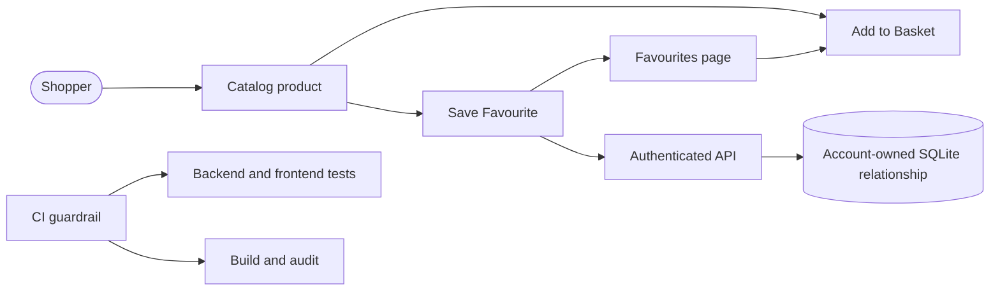

## Summary

Adds private, persistent Favourites for authenticated Shoppers, including optimistic heart toggles with visible rollback errors, a protected Favourites page, account isolation, and resilient authentication transitions. Adds CI quality gates, a one-command Windows verifier, a durable workflow receipt, and multi-level Mermaid architecture documentation.

See the [architecture diagrams](https://github.com/lucaintini/workshop-mp-skills-for-ai-native-devs/blob/mash/part-2-new-features/docs/architecture.md) and [six-stage workflow receipt](https://github.com/lucaintini/workshop-mp-skills-for-ai-native-devs/blob/mash/part-2-new-features/.scratch/favourites/loop.md).

## Evidence

- **Before:** Shoppers had no way to save catalog items, and the repository had no CI workflow enforcing its existing checks.
  **After:** 46 backend tests and 12 frontend tests pass; the Vite production build succeeds; `npm audit` reports 0 vulnerabilities; browser verification reaches `/favourites` successfully. A Windows verifier now finds stale-PATH tools, protects unrelated processes, restores the local app after clean installs, and can detect when an installed plugin is not actually invocable.

## Merge Danger

**Door:** two-way

The feature and CI workflow can be reverted without destructive data migration. The new table is additive.

**Blast Radius:** shop

Touches catalog cards, authenticated navigation, SQLite schema initialization, and account-scoped API routes. Basket, checkout, and Orders behaviour remain unchanged and covered by the full backend suite.
