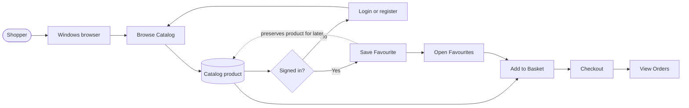
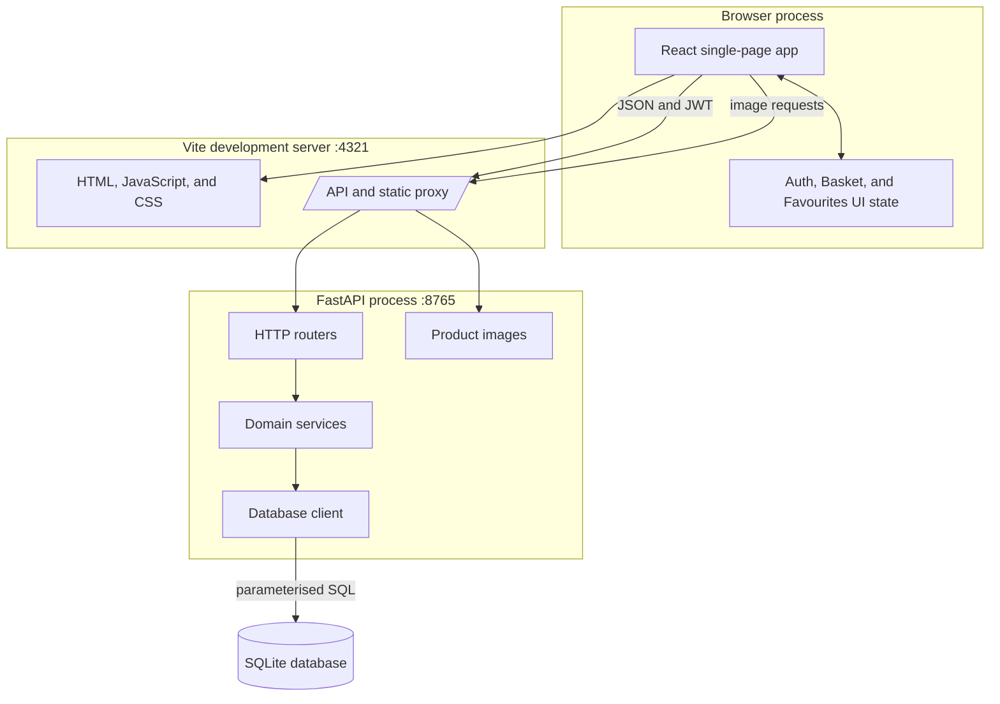
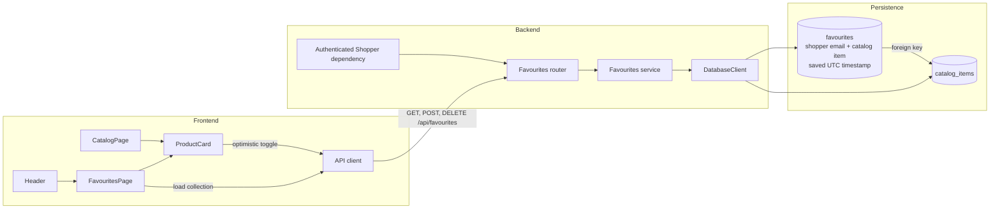
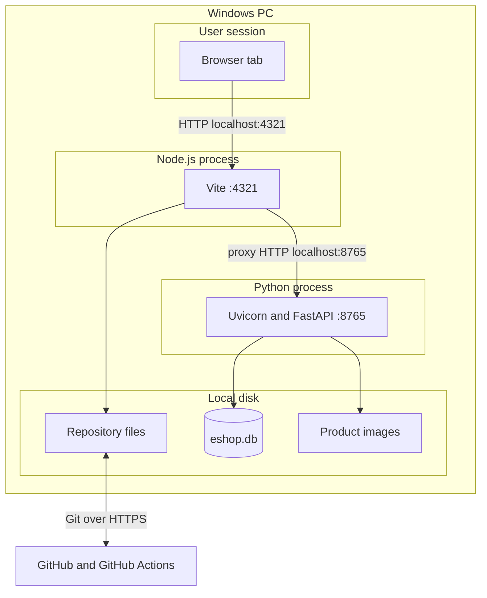
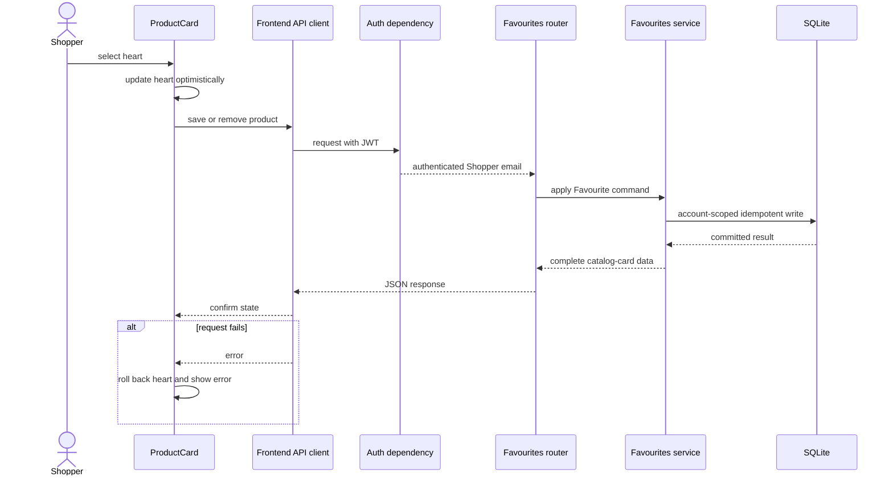

# eShop architecture

These views move from the Shopper's complete journey to the implementation and runtime details. Names match `GLOSSARY.md` and the codebase.

## 1. Shopper-to-product journey

The Favourites path helps a signed-in Shopper return to a product. It never changes Basket, checkout, or Order state.

## 2. High-level software architecture

## 3. Low-level Favourites architecture

The unique Shopper/product relationship makes saves idempotent. The authenticated Shopper identity scopes every read and write. Failed optimistic changes roll back in the UI and remain visible as errors.

## 4. Runtime and hardware topology

All application traffic stays on the local Windows PC. GitHub stores source history and runs clean-room CI; it does not host the local shop.

## 5. Favourite data flow

Every boundary is exercised through the FastAPI HTTP seam in backend tests and through component/router behaviour in frontend tests.
